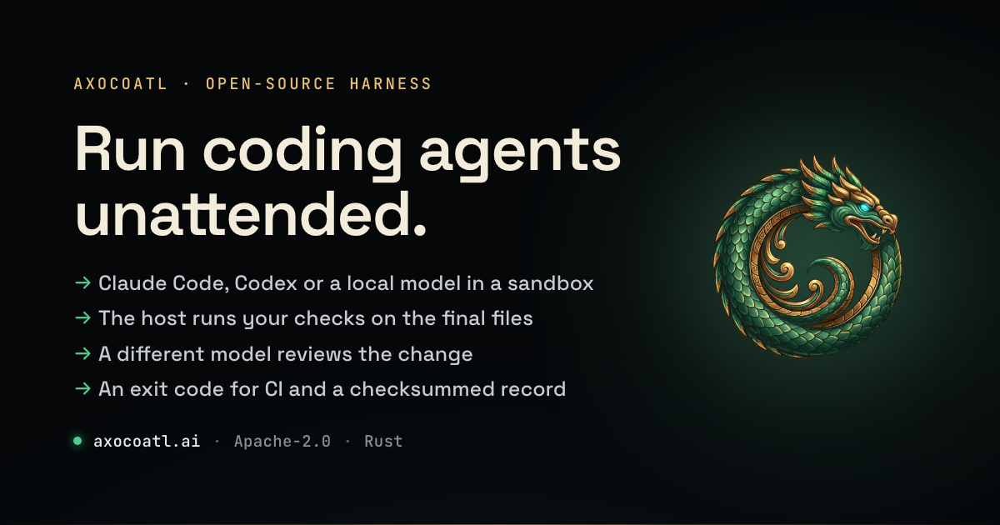

# Axocoatl

**Run coding agents unattended, and let the host decide when they are done.**

Claude Code, Codex or a local model works in a sandbox its model credential never
enters. When it says it is done, the host runs your tests on the final files and a
different model reviews the change. You get an exit code for CI and a checksummed
record of every step. One open-source Rust executable; no Axocoatl account or telemetry.

[](https://github.com/axocoatl/axocoatl/actions/workflows/ci.yml) [](https://crates.io/crates/axocoatl-cli) [](LICENSE)

```bash
curl -fsSL https://axocoatl.ai/install.sh | sh   # macOS 11+, glibc 2.35+ Linux, or WSL2
axocoatl onboard   # configure this OS user; choose Ollama or OpenRouter
axocoatl doctor    # check Podman (the sandbox) and the provider
axocoatl dev       # start the daemon and leave it running

cd ~/src/my-app    # then, in another shell
axocoatl run fix --task "Paging skips the last item when the total is a multiple of the page size" \
  --model writer=ollama:qwen3-coder:30b --model reviewer=ollama:gpt-oss:120b \
  --junit axocoatl-junit.xml --record run.axorecord.jsonl
```

An example of the summary a passing run prints on standard output, in the format
`axocoatl run` prints it (progress goes to standard error):

```text
Verdict: pass (exit 0)
Loadout: fix@1 sha256:b579bd67515486bebaf28d2bbfc76853260abef7623a05d2d5f83c1593cc9b41
Checks:
  tests            passed, exit 0
Review: approved after 2 of 3 rounds by ollama:gpt-oss:120b
Adjudications:
  round 1 F1   accept: the last page was dropped when total % size == 0; fixed, with a test
  round 1 F2   reject: Paginator.__init__ already refuses size 0 (pages.py:12)
Usage: 412907 input + 23118 output tokens, $0.0000
Network: 0 recorded events, 0 allowed and 0 refused connections, 0 route requests
Record: run-7f3c9a2e-4b1d-4c8a-9e6f-2d5b8a1c0e47
```

- **Claude Code or Codex as the writer.** The Claude Code CLI or the Codex CLI runs
  inside the Session container as a non-root user, and the host runs the same checks and
  review on what it leaves. `axocoatl connect claude-code` (it runs `claude setup-token`)
  or `axocoatl connect codex` (your ChatGPT sign-in, in a browser) stores the credential
  on your computer without showing it; the daemon adds it on the host to each model
  request, and the container holds a placeholder. For now this takes a loadout you write:
  see [External agents](https://docs.axocoatl.ai/configure/external-agents/).

<p align="center">
  
</p>

## What a run does

A **loadout** is a YAML recipe for one run: its Agents (the model-driven workers) and
their models, the required checks with their timeouts, a required reviewer, the network,
the budgets and the prompt. `axocoatl run` hands one to the running daemon, which runs
it in a **Session**: one durable work item with its conversation, the sandbox its tools
run in, and its record.

- **Three built-in loadouts.** `fix` runs one writer, your check command as a required
  check, and a required review by a different model for up to 3 rounds; the writer must
  answer every finding with accept or reject and a reason. `qa` runs one browser explorer
  whose findings carry Playwright reproductions the host re-runs. `audit` (opt-in: it
  runs only when named) plans areas, reads them with parallel read-only workers and
  merges the findings. Your own loadouts are YAML files in the `loadouts/` directory
  beside your configuration.
- **A sandbox with no direct network.** A loadout's Session always runs under network
  egress (or none) with non-root workload users; the container has no direct network
  access and reaches the outside only through the daemon's egress proxy and routes,
  which decide and record every connection. Your global defaults do not change.
- **The host decides.** Required checks run on the exact final files, by the host. A
  reviewer on the writer's own model is warned about, not refused. A finding left
  unanswered, a check that did not run, or anything not covered makes the run need
  attention; nothing passes by default.
- **A verdict for CI.** Exit codes: 0 pass, 1 checks failed, 2 needs attention, 3 usage,
  4 daemon unavailable, 5 infrastructure, 6 interrupted, 7 busy. `--junit` writes JUnit of
  the checks, review, adjudications, findings and coverage. `--record` writes the whole
  run as one JSON Lines file ending with its line count and SHA-256, which
  `axocoatl record verify` checks; it is checksummed, not signed.
- **Keep as PR.** `--keep branch` commits exactly the run's changed paths to a new branch
  with your `git`, without touching your checkout; `--keep pr` also pushes it and opens a
  pull request with `gh`.

Details: [Loadouts](https://docs.axocoatl.ai/configure/loadouts/),
[`axocoatl run`](https://docs.axocoatl.ai/reference/run/),
[Fix, QA and audit runs](https://docs.axocoatl.ai/workbench/fix-qa-audit/) and
[Keep as PR](https://docs.axocoatl.ai/workbench/keep-as-pr/).

## What we measured

<!-- measured: axocoatl-1.1.0 2026-10-01 -->
A pre-registered benchmark with small local models, measured through Axocoatl 1.1.0
and, for comparison, a plain agent loop: 6 Python maintenance tasks frozen on
2026-09-22, scored by 25 withheld tests the agents never see. The writer is qwen3-coder
30B running locally; one run per task, temperature 0.

**Through Axocoatl 1.1.0:**

| Setup | Withheld tests passed | Tokens vs. one pass |
| --- | --- | --- |
| One Agent, one pass | 17 / 25 | 1× |
| The same writer with a Required review by a stronger local model (gpt-oss 120B) | **19 / 25** | 2.6× |

The reviewer reported 15 defects and 14 were real. The writer applied every finding it
received, including the one false alarm, which cost a test; 6 real findings came in the
second and last review round, after which Axocoatl stops revising.

**Where extra tokens help** (same tasks, a plain agent loop, not through Axocoatl):

| Setup | Withheld tests passed | Tokens vs. one pass |
| --- | --- | --- |
| The same Agent reviews its own work | 17 / 25 | 3.5× |
| A fresh reviewer on the same model (it approved every change) | 17 / 25 | 2.3× |
| The same model writes its own tests (4 of 6 tasks run) | one more test | 9–15× |
| A stronger reviewer (gpt-oss 120B) | 20 / 25 | 3.3× |
<!-- /measured -->

A stronger, different reviewer helped a small local writer; a second look from the same
model didn't: extra tokens helped when they bought a stronger model's judgment, not
more looks from the same model. That is one small benchmark with two local models, not
a claim that Axocoatl makes agents better. Axocoatl lets each Agent use its own model,
so a local writer can be reviewed by a stronger model, and the host still runs your
checks and records every step. The reviewer we measured ran locally; reviewers through OpenRouter
have not been measured, and neither have the built-in loadouts of 1.3. We do not claim
the default team beats a single Agent; one Agent remains the cheaper choice for small
tasks.

The built-in loadouts run one writer or one explorer, and `audit` is opt-in, following
studies that ran with Claude Code subagents, not through Axocoatl. They, the method and
the limits are in [What we measured](https://docs.axocoatl.ai/understand/what-we-measured/),
and every public number with its evidence is in [`docs/CLAIMS.md`](docs/CLAIMS.md).

---

## How the boundaries work

### Isolation built in

- **Every Session's repository tools run in a sandbox.** File, shell and terminal
  tools run in a rootless Podman container on your machine by default; E2B Cloud is
  an explicit remote option on the compatibility path. The web and MCP tools run on
  the host, and the browser tools in a container of their own. Interactive Sessions
  have network access by default (`sandbox.network: bridge`); set
  `sandbox.network: none` for repositories you don't trust. A loadout run's container
  has no direct network access (see above).
- **Read-only helpers cannot write files or open TCP connections.** They get no
  file-writing tools, and the kernel blocks their shell from writing, creating,
  renaming or deleting repository files and from opening TCP connections (Landlock,
  Linux 6.7 or later). Otherwise they get no shell. A helper's shell that runs as
  root, or any on macOS, can still change permission bits and timestamps; UDP
  follows the sandbox's network setting; and web or browser tools its template
  lists still reach out. See
  [the security guide](https://docs.axocoatl.ai/operate/security/#constrain-sandbox-execution).
- **Per-Agent write scopes in one checkout.** An Agent's file tools refuse paths
  outside its scope, and every change it made is checked against complete,
  digest-verified snapshots of the repository from before and after its work. For
  an Agent with a shell, that check is review evidence, not confinement.

### A complete record

- **The host runs your checks.** Required checks run after the Agents finish, on
  the exact final files; a required review is run by the host with a read-only
  reviewer, and requested changes go back to the Lead for a bounded number of rounds.
- **Budgets you approve.** Every Agent runs under limits you set. A model call is
  charged what it actually used once the provider reports it, and grants and budgets
  carry across restarts.
- **Every step is kept.** The Session durably records every model call, tool call,
  budget decision and check, next to the conversation, Files, Terminal, Preview and Git.

### Any model, per Agent

- **Each Agent has its own provider and model.** Local models through Ollama,
  hosted models through OpenRouter, with budgets enforced on both. Adapters for
  Anthropic, OpenAI, Gemini and Mistral are included on the compatibility path.
- **Provider failures are handled, and recorded.** A native Session's model call that
  fails with 429, a 5xx status, a timeout or a reset connection before any response
  arrives is retried once on the same model; 400 to 403 are not retried. An Ollama stream that ends early is retried once, older tool output
  is replaced by a short placeholder in later requests, and a request that would
  overflow the context window is trimmed instead of failing.

Axocoatl adds no product telemetry and needs no Axocoatl account.

---

## The browser workbench

The same daemon serves a workbench in your browser for work you want to watch: the
default is one Agent, the Lead, which writes; read-only helpers it can delegate to,
and checks and a review the host runs before a turn completes, are opt-in.

The execution contracts below describe the 1.3.1 source tree. The installer and
`cargo install` select published releases; see the [changelog](CHANGELOG.md)
for versioned changes.

```bash
axocoatl onboard   # configure Axocoatl for this OS user
axocoatl doctor    # check your environment
axocoatl dev       # start the daemon and the one app
# Open the "Sign in:" link it prints (http://localhost:8080/?token=…).
# `axocoatl url` prints it again.
# Choose Open workspace… in the app to authorize a repository.
```

Prebuilt releases support macOS 11 or newer and GNU/Linux with glibc 2.35 or
newer on x86_64 and ARM64. Windows runs through WSL2; there is no native Windows
binary.

Prefer Cargo? `cargo install axocoatl-cli` (requires Rust 1.88+).

Cargo and source builds compile the host application and include Axocoatl's prebuilt
Linux process supervisor inside the same executable. It needs no separate installation
or startup download. Its source and [explicit rebuild procedure](docs/EXEC_SUPERVISOR_BUILD.md)
are included in this repository.

`axocoatl onboard` creates no project, repository, Workspace, or Session. It
writes one owner-only user configuration and platform data directory. Repositories
become Workspaces only when you authorize them through **Open workspace…**.

The configuration defines a default team: **Lead**, which owns the change and
edits files, and **Scout** and **Reviewer**, read-only helpers Lead can delegate a
question or a review to. A new Session starts with one Agent, Lead: in **Team &
budget** you enter its limits and choose **Apply** before the first request. The
helpers and a required review are opt-in there; select **Let this Agent delegate to
helpers** to add Scout and Reviewer and enter their limits too. Helpers cost extra
tokens, and one Agent is cheaper for small tasks. To change the team, see
[Default team](https://docs.axocoatl.ai/understand/coordination/#default-team).

> **Advanced project-local configuration:** `axocoatl init <name>` scaffolds an
> explicit local `axocoatl.yaml`. Pass it with `--config`; Axocoatl never selects
> a repository's configuration merely because it is the current directory.

### From request to reviewed change

1. Open or resume a Workspace Session.
2. In **Team & budget**, enter the limits for Lead and its helpers, and add any
   required checks or a required reviewer. Choose **Apply** before the first Send.
3. Ask for the change. Lead reads and edits the repository and delegates
   questions or a review to its helpers. The Agent graph shows each helper it
   started and what it returned.
4. If the team has required checks, the host runs them after the Agents finish;
   a required reviewer then reads the result, and requested changes go back to
   Lead for another round. The turn completes only when both pass; otherwise it
   needs attention and says why.
5. When an implementation decision needs independent evidence, turn on
   **Explore several ways** instead, compare Outcome and Route, run Checks and an
   optional Judge, and choose **Keep this one**.
6. Open **Last turn** in Source Control, review the current attributed diff,
   stage what you want, and commit deliberately.

### What else the workbench does

- **One executable, one browser surface.** `axocoatl dev` starts the local daemon
  and serves the embedded workbench at `http://localhost:8080`, behind a
  per-daemon sign-in token. Conversation stays
  central while Files, Source Control, Preview, Terminal, History, and focused review
  open around the active Session.
- **The Session survives the process.** Accepted turns have stable identities and
  explicit running, completed, failed, cancelled, or interrupted states. Reopen a
  Session, search its History, export Markdown or JSON, and keep bounded context tied
  to the work it informed.
- **Knowledge carries into the next Session.** Keep versioned Markdown decisions,
  conventions, and findings in the Workspace. Open **Knowledge** to inspect their
  sources, backlinks, proposals, and graph, or attach an exact note revision to chat.
  Native Agents can retrieve notes and propose updates; accepted publication remains
  separate from speculative work. A bounded code map exposes observed definitions
  and imports, with source changes and unavailable evidence kept visible.
- **Every activation stays inspectable.** Native turns bind each Agent activation
  to an immutable definition, input, conversation, and approved budget. The Agent
  graph shows generations, output, usage, and causal evidence, including a
  "delegated" edge from a lead to each helper, with missing details labeled.
  **Team & budget** reviews future turns; current-turn controls act on exact
  recorded generations. A lead delegates only to helper templates you approved,
  within limits reserved from its own grant.
- **Explore several ways before you choose.** Give the same request and repository
  snapshot to different Agent/model pairs. Each attempt gets an independent checkout
  and sandbox. Compare Outcome and Route, inspect changed paths and diffs, run Checks
  and an optional Judge, and see usage and known cost before you Keep one.
- **Keep is a Git decision, not an automatic commit.** **Keep this one** applies the
  selected candidate to the primary checkout, records its output and turn attribution
  in durable Session History, and removes the unresolved runtime set. Native Ways also
  retain the bounded candidate comparison and human decision after cleanup, including
  decisions that keep nothing. Set explicit History storage limits before starting Ways.
  **Last turn**
  filters the current Git diff to paths attributed to that turn so you can review,
  stage, and commit deliberately.
- **Execution and providers remain your choice.** Rootless Podman is the local
  default. Native repository tools and checks require its process supervisor;
  E2B Cloud remains an explicit remote option on the compatibility path. Provider
  adapters include Ollama, OpenAI, OpenRouter, Anthropic, Gemini, Mistral, and one
  OpenAI-compatible endpoint, subject to the execution contracts below.

## Execution contracts

New data roots use the native Session controller. **Team & budget** requires explicit
limits and expiry before execution. Its enforced provider boundary currently supports
reviewed local Ollama profiles and eligible OpenRouter text/tool endpoints, reasoning
models included, paid with OpenRouter credits. OpenRouter requires
`providers.openrouter_billing: credits`, a normal API key, and an account with no
connected BYOK provider keys. BYOK is not supported. A compatible HTTP API alone does not establish a bound.
The onboarding wizard offers Ollama and OpenRouter for native Sessions. For Ollama it
checks that the server is a loopback Ollama 0.20.6 with its cloud features disabled
(`OLLAMA_NO_CLOUD=1`, or `{"disable_ollama_cloud": true}` in `~/.ollama/server.json`),
and suggests Lead and Reviewer models from those installed on it; `axocoatl doctor`
reports the same requirements.
Direct OpenAI and Anthropic configurations remain available through manual YAML
on their supported compatibility paths.
The other configured provider adapters remain available through their supported legacy
and compatibility paths. Existing legacy roots are not silently converted. After
stopping the daemon and making a cold backup, use `axocoatl session upgrade --confirm`
to convert the existing data. History and usage remain; historical Agent state whose
role was not recorded stays archived instead of becoming future model context.

### Recovery and compatibility boundaries

- **Durable turn identity and lifecycle.** Axocoatl records a request and immutable
  context references before execution. Exact Stop targets one active turn; cooperative
  cancellation lets an already-started side-effecting tool reach a safe boundary.
- **Reviewed repository setup.** Detected setup such as `npm ci` is an exact,
  unchecked proposal, not consent. Repository tools remain unavailable until the
  Session environment is durably Ready. Axocoatl can provision required commands in
  an approved sandbox, but it does not install Podman or create its VM.
- **Legacy Ways recovery.** Unresolved lifecycle, output, Route, failure, usage, cost,
  optional Judge, and protected Check evidence rehydrate. Before Checks protects a
  candidate identity, a restart cannot restore its live changed-path or diff evidence.
  In v1, Ways requires an autonomous single-Agent Session on local Podman; attachments,
  Skills, MCP tools, and web search are withheld from candidate attempts.
- **Legacy post-Keep history.** The kept task, output, and turn attribution join
  canonical Session History. Candidate Routes, diffs, Checks, Judge ranking, and
  cost do not. **Last turn** is a filter over the current working tree, not a frozen
  per-turn patch.
- **Local-first, not an offline guarantee.** Axocoatl adds no product telemetry,
  hosted control plane, or Axocoatl account. Configured providers, MCP servers, web
  search and `web_fetch`, webhooks, E2B Cloud, Podman image or package downloads,
  repository traffic, the browser tool's declared hosts and the downloads
  `axocoatl browser install` makes, requests the daemon sends on egress routes, and
  the embedding-model download can use the network. `sandbox.network: none` blocks
  the local container and turns off native Sessions' web tools; the daemon's other
  integrations remain separate paths.

The exact storage, isolation, setup, recovery, and network contracts are documented
in [`docs/PRODUCT.md`](docs/PRODUCT.md), [`docs/ARCHITECTURE.md`](docs/ARCHITECTURE.md),
and [the security guide](https://docs.axocoatl.ai/operate/security/).

---

## Workspace knowledge

The Knowledge inspector shares accepted notes across Sessions in one Workspace.
Notes retain their revision, origin, source hashes, and typed links. Edit them in
the workbench or explicitly import/export Markdown for another editor; no vault is silently added
to your repository. Native requests retain a bounded selection of relevant note
revisions with their origin and source applicability. Search and the cached code
map help an Agent choose what to read next.

Each Session retains its own source index, which parses Rust, JavaScript, TypeScript, TSX, and Python definitions
and import syntax. It is a bounded observed index, not a complete reference or call
graph. Refresh it after source changes and inspect the current files before relying
on a remembered explanation. A changed hash signals that its evidence needs review.

Model proposals do not become accepted knowledge just because a tool call finished.
Publication checks accepted activation state and expected note revisions. For an
isolated Way, automatic publication also requires its exact retained Keep decision;
other candidates stay pending for explicit human review. Human edits and conflicts
remain explicit. **Investigate in chat** attaches a selected
note and prepares a follow-up request under ordinary Session authority and budgets.
Read [Workspace knowledge](https://docs.axocoatl.ai/workbench/knowledge/).

## Concepts

- **Workspace**: a repository folder you named and authorized in the app.
- **Session**: one durable work item inside a Workspace: its conversation, the sandbox
  its tools run in, and its record. A loadout run creates one too.
- **Turn**: one accepted request with its context, output and final state.
- **Agent**: a configured model-driven worker with its own provider, model, tools and
  limits. In a team, the **lead** writes and **helpers** only read.
- **Grant**: the limits you approve in Team & budget for an Agent: activations,
  invocations, tokens, cost and expiry.
- **Required checks and required review**: completion conditions the host evaluates on
  the exact final tree; the Agents cannot skip or answer them.
- **Loadout** and **run**: a YAML recipe for one run, and one headless execution of it
  through `axocoatl run`, ending in an Outcome and an exit code. An **adjudication** is
  the writer's accept or reject, with a reason, of one review finding; **not covered**
  lists what ended without a result, never counted as a pass.
- **Attempt** (a Way): one candidate solution when a Session explores several.

The runtime and legacy concepts (memory tiers, the Coordinator role, Automations, the
event feed, protocols) are in [`docs/ARCHITECTURE.md`](docs/ARCHITECTURE.md#concepts-reference).
See [`docs/PRODUCT.md`](docs/PRODUCT.md) for the product model, the
[docs site](https://docs.axocoatl.ai) for the full guide, the
[marketing site](https://axocoatl.ai) for the positioning, or
[`docs/ARCHITECTURE.md`](docs/ARCHITECTURE.md) and
[`docs/TROUBLESHOOTING.md`](docs/TROUBLESHOOTING.md) for the in-repo
quick reference.

---

## Selected CLI commands

Run `axocoatl --help` and `axocoatl <subcommand> --help` for the authoritative
surface of the installed version.

```
axocoatl onboard                 Configure Axocoatl for this OS user
axocoatl doctor                  Environment / dependency health check
axocoatl init <name>             Scaffold an explicit project-local config
axocoatl validate <config>       Validate a config file
axocoatl dev | serve             Run daemon (+ IPC) / production server
axocoatl url                     Print the browser sign-in link
axocoatl chat -a <agent>         Interactive chat
axocoatl session upgrade --confirm  Convert stopped legacy Session storage after backup
axocoatl run <loadout> --task "…"  Run a loadout headless; --junit, --record, --keep
axocoatl loadouts list|show|validate
axocoatl record verify <file>    Check a run's record bundle
axocoatl connect claude-code     Sign in Claude Code and store its token, never shown
axocoatl connect codex           Sign in Codex with your ChatGPT plan, never shown
axocoatl connect codex --api-key  Also store the OpenAI API key OpenAI issues, never shown
axocoatl connect codex --status|--refresh  Show the sign-in, or refresh it now (no token shown)
axocoatl secret set <name>       Store another route credential from stdin or --from-env VAR
axocoatl recipe build <recipe>…  Build a Session image (claude-code, codex, e2e)
axocoatl workflow list | run     Compatibility view/run for manual Automations
axocoatl agents list|status|restart
axocoatl tokens report           Per-agent token usage
axocoatl mcp servers|tools       Inspect connected MCP servers/tools
```

## Selected HTTP endpoints

This is a quick integration sketch, not an exhaustive route reference. See the
[HTTP API overview](https://docs.axocoatl.ai/reference/http-api/) and current server
router for the full surface. Every route except the health probes and static assets
needs a credential; locally, send `Authorization: Bearer <token>` with the token
from `local-api-token` in the data directory.

```
GET  /health                          POST /api/agents/{id}/execute
GET  /api/agents                       GET  /api/agents/{id}/status
POST /api/agents/{id}/restart          GET  /api/tokens/report
GET  /api/workflows                    POST /api/workflows/{id}/execute
GET  /api/mcp/servers                  GET  /api/mcp/tools
GET  /api/workspaces                   POST /api/workspaces
GET  /api/workspaces/{id}/sessions     POST /api/workspaces/{id}/sessions
GET  /api/sessions/{id}/turns          GET  /api/session-turns/search?q=...
GET  /api/sessions/{id}/export         POST /api/sessions/{id}/rewind
GET  /api/sessions/{id}/attachments    POST /api/sessions/{id}/attachments
GET  /api/loadouts                     POST /api/runs
GET  /api/runs/{run_id}                GET  /api/runs/{run_id}/record
GET  /ws   (WebSocket streaming)
```

The retained lightweight Chat and global FileStore routes are compatibility APIs for
integrations. They do not restore directoryless Chat or cross-chat Files as browser
destinations; the app keeps conversation history and attached context inside a Session.

## Examples

Every example is runnable with a mock LLM — **no API keys needed** — unless
noted. See [`examples/`](examples/).

**Recovery**
- [`crash-recovery`](examples/crash-recovery) — a standalone example-owned behavior that resumes a multi-step workflow checkpoint without re-running completed steps; this is not the normal Session Coordinator terminal-recovery contract.

**Memory & providers**
- [`memory-recall`](examples/memory-recall) — agent-managed core memory, semantic recall, and sleep-time consolidation (Tiers 3–4); runs offline.
- [`multi-provider`](examples/multi-provider) — per-agent provider selection: a cheap local model for simple steps, a frontier model for the hard one, with a per-tier cost breakdown.

**Tools, protocols & integration**
- [`tool-hooks`](examples/tool-hooks) — pre/post tool hooks that deny a path-traversal write, audit every call as JSON, and let the agent recover.
- [`mcp-bridge`](examples/mcp-bridge) — call an external MCP tool over stdio through the real `McpToolRegistry`; plus how to expose agents as an MCP server.
- [`a2a-server`](examples/a2a-server) — expose an agent over the A2A protocol (agent card + task endpoint) and call it from a client, in-process.
- [`sandbox-session`](examples/sandbox-session) — the rootless Podman sandbox for agent tool execution: threat model, config knobs, and a live integration test (needs Podman).

**Autonomy & config**
- [`proactive-agents`](examples/proactive-agents) — legacy YAML projected into canonical scheduled and event-triggered Automations, plus an offline guard demonstration.
- [`configs/`](examples/configs) — a gallery of minimal YAML configs for common recipes (research pipeline, feature dev, incident response, local-only, MCP, event webhooks). No Rust.

**Foundations**
- [`research-assistant`](examples/research-assistant), [`code-reviewer`](examples/code-reviewer), [`customer-support`](examples/customer-support) — library-level mock-provider examples: a two-Agent pipeline, a Coordinator that splits a review across Workers, token budgets, and session/checkpoint memory.

## Build from source

```bash
git clone https://github.com/axocoatl/axocoatl
cd axocoatl
cargo build -p axocoatl-cli --release  # binary: target/release/axocoatl
cargo test --workspace
```

## License

Apache-2.0 — see [LICENSE](LICENSE). Changes: [CHANGELOG.md](CHANGELOG.md).
