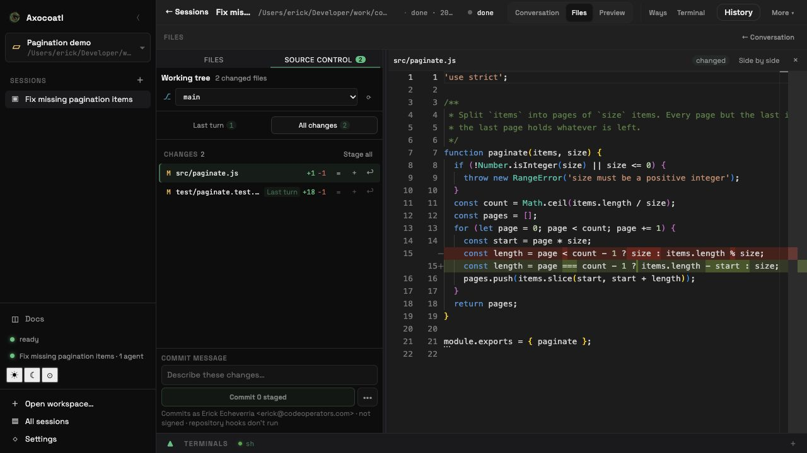
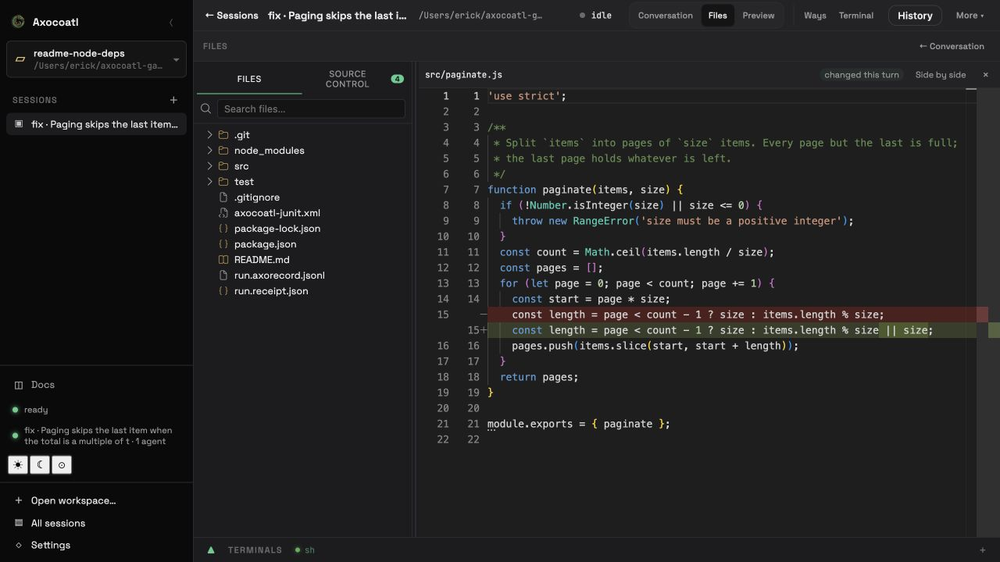
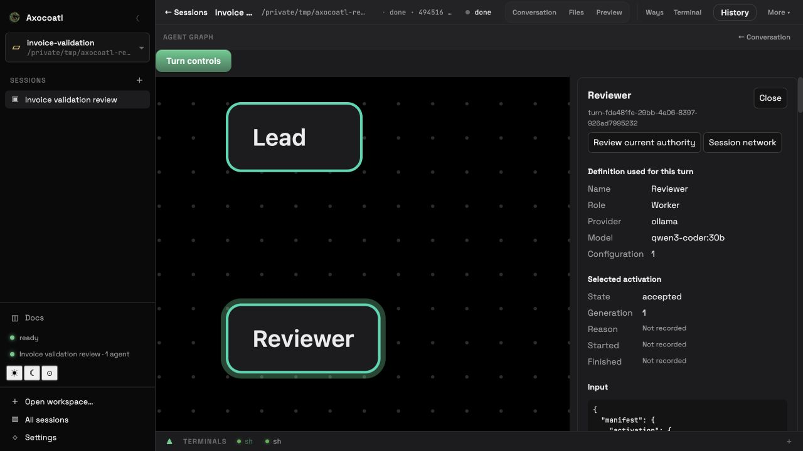

# Axocoatl

**Run coding agents unattended, and let the host decide when they are done.**
Agents write the code. Axocoatl writes the receipt.

Open your repository, ask for a change, and follow the work in one dashboard.
Conversation, Files, Preview, Terminal and Git stay with the same Session.
Review the actual changes before you commit.

[](https://github.com/axocoatl/axocoatl/actions/workflows/ci.yml) [](https://crates.io/crates/axocoatl-cli) [](LICENSE)

[](https://axocoatl.ai/#dashboard-task)

**[Watch a task from request to verified files](https://axocoatl.ai/#dashboard-task)** ·
[Create your first Session](https://docs.axocoatl.ai/start/first-session/) ·
[Tour a saved run and its receipt](https://axocoatl.ai/#verified-fix)

An edited recording of one prepared pagination task in the actual dashboard.
It retains model failures, recovery requests, a test-restoration correction and a
change from Qwen3-Coder 30B to GPT-OSS 20B. The final files preserve all four original
tests, add the requested regressions and pass independent checks. This is one
prepared fixture, not a model comparison.

For finished native Session turns, open **Signed receipt** in Conversation or History.
Download signs the retained turn evidence so you can verify its recorded checks, review
and captured files offline. The
recordings above predate dashboard receipts; the separate saved-run tour shows a
CLI-launched fix with required checks, review and a signed receipt.

<details>
<summary><strong>See the saved run's actual diff, checks and receipt</strong></summary>

[](https://axocoatl.ai/#verified-fix)

[Watch the saved-run tour →](https://axocoatl.ai/#verified-fix)

</details>

## A required review, on screen

[](https://docs.axocoatl.ai/configure/cross-model-review/#watch-a-required-review)

**[Watch the required-review walkthrough](https://docs.axocoatl.ai/configure/cross-model-review/#watch-a-required-review)**

Two requests with a local GPT-OSS 20B lead, a read-only Qwen3-Coder 30B reviewer,
and required `npm test` checks. The first review approved a change that let an
oversized price become `Infinity`; independent checks caught it, and a follow-up
restored the guard and passed fresh checks and review. An AI assistant operated the
actual dashboard in Dark mode; waits are trimmed and sped up. This prepared task
is separate from the historical benchmark. A reviewer is evidence, not a guarantee.

[0:00 · Set requirements](https://docs.axocoatl.ai/configure/cross-model-review/?t=0#required-review-video) ·
[0:35 · Watch review](https://docs.axocoatl.ai/configure/cross-model-review/?t=35.345#required-review-video) ·
[0:45 · Check independently](https://docs.axocoatl.ai/configure/cross-model-review/?t=44.645#required-review-video) ·
[1:15 · Review corrected result](https://docs.axocoatl.ai/configure/cross-model-review/?t=74.77#required-review-video)

## Open your first Session

```bash
curl -fsSL https://axocoatl.ai/install.sh | sh
axocoatl onboard --start none
axocoatl doctor
axocoatl dev
```

Leave that terminal running. In a second terminal, run `axocoatl url` and open the
sign-in link. If a daemon or service already runs with this configuration, use it
instead of starting another copy.

1. Choose **Open workspace…** and select your repository.
2. Create a **New session**, review its environment, and apply **Team & budget**.
3. Ask for one concrete change. Follow the work in Conversation, then inspect
   **Files → Source Control → Last turn** before committing.
4. Choose **Download signed receipt** beneath the finished turn to retain its
   evidence for offline verification.

Onboarding configures this OS user; it creates no project or repository. It asks
before installing Podman and, on macOS, creating its virtual machine. Verified
setup paths are Apple-silicon macOS and Ubuntu 24.04; other platforms are not yet
verified end to end. [Requirements and setup →](https://docs.axocoatl.ai/start/install/)

## Choose how to work

| | Dashboard Session | Headless fix run |
| --- | --- | --- |
| **Start** | Ask in Conversation | Run a built-in fix loadout from your shell |
| **Writer** | Ollama or OpenRouter | Claude Code, Codex, Ollama or OpenRouter |
| **Checks and review** | Opt in through Team & budget | Required by the built-in fix loadouts |
| **Inspect** | Files, Git diff, tool calls, History and a signed turn receipt | The same dashboard, plus Run outcome and a signed run receipt |

A new Session starts with one Agent. Add read-only helpers or explore several
Ways when the task calls for them. Helpers and review cost extra tokens. [Session guide →](https://docs.axocoatl.ai/workbench/session/)

For unattended fixes, choose a writer and a different reviewer. The host runs
required checks on the final files. The receipt records the verdict, models,
checks, review and covered file hashes, including capture timing and coverage limits;
it proves which key signed those facts,
not that the code is correct. Signing or storage failure reports
`receipt_unavailable`; pre-admission refusals have no receipt.
[Receipts →](https://docs.axocoatl.ai/workbench/receipts/) ·
[Claude Code and Codex →](https://docs.axocoatl.ai/configure/external-agents/)

## Keep control of the work

- **Inspect the result.** Read edits in Files, inspect the Git diff, and use
  Preview for a running web app. Stage and commit deliberately.
- **Set the limits.** Review the model, tools and budget before the Agent starts.
  Stop addresses the active turn; failed and interrupted work remains in History.
- **Choose local or hosted models.** Native Sessions use Ollama or OpenRouter.
  Repository tools run in local rootless Podman by default. Hosted providers
  receive the context sent to them; downloads and tools can also use the network.
- **Compare when useful.** Explore several Ways, inspect their Outcome and Route,
  then choose **Keep this one**. It does not automatically commit the result.

One open-source Rust executable. No Axocoatl account or product telemetry.
[Security and limits →](https://docs.axocoatl.ai/operate/security/)

<details>
<summary><strong>Run a headless fix and verify its receipt</strong></summary>

Keep the daemon running. In a second terminal, enter the repository you want to
change. This example uses the local or OpenRouter writer configured in onboarding:

```bash
cd ~/src/my-app
AXO_EVIDENCE=$(mktemp -d "${TMPDIR:-/tmp}/axocoatl-first-fix.XXXXXX")
# Local or OpenRouter writer; choose the corresponding external loadout otherwise.
axocoatl run fix --task "Paging skips the last item when the total is a multiple of the page size" \
  --junit "$AXO_EVIDENCE/junit.xml" --record "$AXO_EVIDENCE/run.axorecord.jsonl" \
  --receipt "$AXO_EVIDENCE/receipt.json"
axocoatl receipt verify "$AXO_EVIDENCE/receipt.json" \
  --key "$(axocoatl receipt key)" --repo . \
  --record "$AXO_EVIDENCE/run.axorecord.jsonl" --require-pass
```

Use `fix-claude-code` or `fix-codex` instead of `fix` for those external writers.
A **loadout** is a recipe for a run: its writer, checks, review and budgets. The
built-in fix loadouts require the repository check and a review; other loadouts
have their own acceptance rules.

Evidence stays outside the repository. Open the run's Session to inspect **Run
outcome**, or verify the receipt offline against a trusted key and the covered
files. Review the diff before committing. The full guide explains all four
writers and the expected outputs:

[Terminal fix guide](https://docs.axocoatl.ai/start/first-fix/) ·
[Run reference](https://docs.axocoatl.ai/reference/run/) ·
[Repository toolchains](https://docs.axocoatl.ai/configure/toolchains/) ·
[Keep as PR](https://docs.axocoatl.ai/workbench/keep-as-pr/)

</details>

<details>
<summary><strong>Measured results and their limits</strong></summary>

<!-- measured: axocoatl-1.1.0 2026-10-01 -->
A pre-registered benchmark with small local models, measured through Axocoatl 1.1.0
and, for comparison, a plain agent loop: 6 Python maintenance tasks frozen on
2026-09-22, scored by 25 withheld tests the agents never see. The writer is qwen3-coder
30B running locally; one run per task, temperature 0.

**Through Axocoatl 1.1.0:**

| Setup | Withheld tests passed | Tokens vs. one pass |
| --- | --- | --- |
| One Agent, one pass | 17 / 25 | 1× |
| The same writer with a Required review by a stronger local model (gpt-oss 120B) | **19 / 25** | 2.6× |

The reviewer reported 15 defects and 14 were real. The writer applied every finding it
received, including the one false alarm, which cost a test; 6 real findings came in the
second and last review round, after which Axocoatl stops revising.

**Where extra tokens help** (same tasks, a plain agent loop, not through Axocoatl):

| Setup | Withheld tests passed | Tokens vs. one pass |
| --- | --- | --- |
| The same Agent reviews its own work | 17 / 25 | 3.5× |
| A fresh reviewer on the same model (it approved every change) | 17 / 25 | 2.3× |
| The same model writes its own tests (4 of 6 tasks run) | one more test | 9–15× |
| A stronger reviewer (gpt-oss 120B) | 20 / 25 | 3.3× |
<!-- /measured -->

A stronger, different reviewer helped a small local writer; a second look from the same
model didn't: extra tokens helped when they bought a stronger model's judgment, not
more looks from the same model. That is one small benchmark with two local models, not
a claim that Axocoatl makes agents better. Axocoatl lets each Agent use its own model,
so a local writer can be reviewed by a different model, and the host still runs your
checks and records every step. The reviewer we measured ran locally; reviewers through OpenRouter
have not been measured, and neither have the built-in loadouts. We do not claim
the default team beats a single Agent; one Agent remains the cheaper choice for small
tasks.

The built-in loadouts run one writer or one explorer, and `audit` is opt-in, following
studies that ran with Claude Code subagents, not through Axocoatl. They, the method and
the limits are in [What we measured](https://docs.axocoatl.ai/understand/what-we-measured/),
and every public number with its evidence is in [`docs/CLAIMS.md`](docs/CLAIMS.md).

</details>

<details>
<summary><strong>Build, configure and contribute</strong></summary>

Build the CLI package explicitly:

```bash
git clone https://github.com/axocoatl/axocoatl
cd axocoatl
cargo build -p axocoatl-cli --release
./target/release/axocoatl doctor
```

The executable is `target/release/axocoatl`. Follow
[CONTRIBUTING.md](CONTRIBUTING.md) for pinned tools and the required preflight
before a pull request. Cargo and source builds include the Linux process
supervisor; its [source and rebuild procedure](docs/EXEC_SUPERVISOR_BUILD.md)
are included.

[Configuration](https://docs.axocoatl.ai/reference/config/) ·
[CLI reference](https://docs.axocoatl.ai/reference/cli/) ·
[HTTP API](https://docs.axocoatl.ai/reference/http-api/) ·
[Examples](examples/) ·
[Architecture](docs/ARCHITECTURE.md) ·
[Release verification](https://docs.axocoatl.ai/operate/verification/)

</details>

[Documentation](https://docs.axocoatl.ai/) ·
[Changelog](CHANGELOG.md) ·
[Apache-2.0 license](LICENSE)
